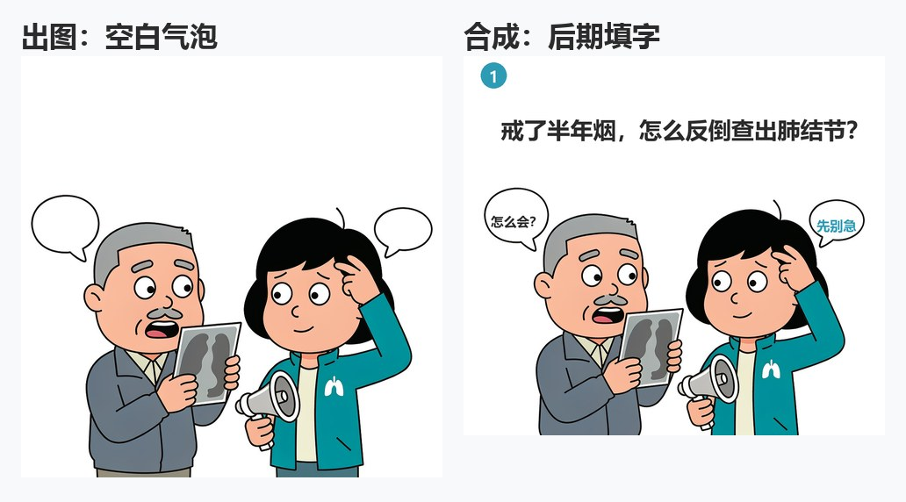

# 科普漫画 science-comic-skill


> 给自媒体一键生成科普漫画的 Agent Skill：选题理解、事实核查、分镜脚本、角色卡锚定一致性、逐格出图、气泡留空后期填字。
>
> One-click science comics for content creators: topic analysis, fact-checking, storyboard scripting, character-card anchoring for cross-panel consistency, and panel-by-panel publishable comic images. [English README](#english-readme)

只需提供一个选题，自动完成从「为什么天空是蓝色的」到一整套可发布漫画图片的全过程：事实准确、角色跨格一致、气泡文字清晰。

---

## 效果预览

下面是一次真实测评的成品，不是单独画的宣传图。样本是 6 格条漫「戒烟这件事」（被测版本 v1.1.0）。要逐格打开原图、看空白气泡对照和知识卡，用浏览器打开 [`examples/samples/lung-cancer-quit/preview.html`](examples/samples/lung-cancer-quit/preview.html)，说明写在 [`EVALUATION.md`](examples/samples/lung-cancer-quit/EVALUATION.md)。




| | 这次实测 |
|---|---|
| 成品 | [`comic-final.png`](examples/samples/lung-cancer-quit/output/comic-final.png)，1080×6382 |
| 调用 | 11 次出图，合格 6 张 |
| 文字 | 模型不写中文，气泡留空后合成 |
| 和现在规则的差别 | 图是旧规则跑出来的。v1.2.0 已改为「气泡把意思说清」，没有按新规则重画这套图 |

只想看流程中间产物长什么样、不看图，仍可看 [`examples/demo-comic.md`](examples/demo-comic.md)。

---

## 目录

- [效果预览](#效果预览)
- [它解决什么问题](#它解决什么问题)
- [设计原理](#设计原理)
- [工作流程](#工作流程)
- [运行依赖](#运行依赖)
- [已知边界](#已知边界)
- [成本参考](#成本参考)
- [快速开始](#快速开始)
- [目录结构](#目录结构)
- [常见问题](#常见问题)
- [License](#license)

---

## 它解决什么问题

直接把"把 XX 做成漫画"丢给 AI，会同时踩三个坑：**事实没人管、中文进图必乱码、主角每格都在换脸**。

这三个坑不是提示词技巧能绕过去的，它们分别是**知识问题、工程问题、模型能力问题**。本 Skill 的做法是把它们拆开，各自用合适的手段解决，而不是指望一个提示词全包。

| | 直接让 AI 画一套 | 纯人工绘制 | 本 Skill |
|---|---|---|---|
| **事实准确性** | 无核查，模型可能顺手编造数字 | 取决于作者水平 | 核查先于创作，每条陈述可回指来源 |
| **文字质量** | 中文进图必乱码错字，且无法无痕修复 | 清晰 | 气泡留空 + 后期合成，清晰、可改、可换字体 |
| **跨格一致性** | 角色每格重新想象，第 3 格起认不出是同一人 | 天然一致 | 角色卡锚定词逐格嵌入（有边界，见下） |
| **出图速度** | 最快 | 最慢 | 中等，含自检与返工 |
| **可维护性** | 改一个字要整张重生成 | 改一处要重画 | 文字层可单独改，画面层可单格重画 |
| **文档化程度** | 无 | 无 | 知识卡 / 角色卡 / 分镜脚本全程留档，可复用可追溯 |

核心差异在最后一栏：**这套流程产出的是"一套可维护的资产"，不是"几张图"。** 知识卡能追溯每个数字的出处，角色卡能在下一期直接复用，分镜脚本能拿来复盘节奏——这些都是重跑一次提示词得不到的。

---

## 设计原理

四条核心设计取舍。每条都写清了**为什么这么选**，以及**不这么做会付出什么代价**。

### 1. 事实核查先于一切创作

创作开始前，先把每个知识点检索核对一遍，产出**知识卡**：一句话结论 + 来源 + 画面化建议。

- **为什么**：漫画越好看传播越广，错误知识被放大得也越狠。画面朴素可以救，知识错了救不了，而且会被更多人记住。
- **代价**：增加了前期工作量，且要求执行者具备联网检索能力。
- **配套约束**：检索不到依据的说法**不猜不编**，也不写成"科学家认为"这类没有出处的泛话——点名缺什么、为什么缺，把决定权交还用户。

### 2. 文字与图像彻底分离

图像模型只负责画**空白气泡**，一个中文字都不许渲染；所有文字在后期用脚本合成。

- **为什么**：图像生成模型渲染中文必然出现乱码、错字、缺笔，而且**无法局部修复**，只能整格重画。把文字交给可控的排版层，是把"不可控"换成"可控"。
- **代价**：需要额外一套文字合成能力（见[运行依赖](#运行依赖)），并需要先定位气泡在图中的坐标。
- **额外收益**：文字变成独立图层后，改文案不必重出图，字体字号可统一管理，还能按平台替换尺寸。

### 3. 角色卡锚定跨格一致性

把角色的外观、配色（写死十六进制色值）、服饰、道具固化成一张**角色卡**，再压缩成一段**锚定描述词**，逐字嵌入每一格的出图提示词。

- **为什么**：图像模型每次出图都是"重新想象"。不锁定描述，第 3 格的主角和第 1 格就会长成两个人，连载直接崩盘。
- **代价**：提示词变长；锚定词一旦定稿就不宜中途修改。
- **两级锚定**：抽象风格词（如 chibi、粗描边）不够。还必须写具象形态（极大圆头、短粗身体、短粗四肢）和肤色色值。重画时加强这一级。
- **重要边界**：锚定只能**降低**漂移概率，不能消除。实测中即使锚定词逐字复用，仍会出现体型与肤色漂移，必须配合出图后的逐格自检与单格重画。详见[已知边界](#已知边界)。

### 4. 质检前置为可执行清单

发布前必须过一遍"**装读者四查**"——假装自己是一个刷到这条漫画的读者，逐项核对：知识可溯 / 角色一致 / 文字清晰 / 节奏。

- **为什么**：创作者视角和读者视角不同。自己知道第 5 格在说什么，读者可能已经划走了。强制做一次视角切换，能抓出自己看不见的问题。
- **代价**：增加一道交付前工序。
- **关键一条**：第二查的做法是"遮住格号，随机抽两格并排看"——这是抓角色漂移最有效的手段。

---

## 工作流程

```
选题分析 → 事实核查（知识卡，来源可溯）
        → 角色卡锚定（外观/色值/画风固化为锚定词）
        → 分镜脚本（每格一个知识点，先确认再出图）
        → 逐格图像生成（锚定词逐字嵌入每格）
        → 气泡文字后期合成（模型不碰文字）
        → 装读者四查（发布前质检）
```

| 阶段 | 产出 |
|---|---|
| 0 成本与产物预告 | 预计调用次数（按约 45% 废片率预留） |
| 1 选题理解与参数确认 | 知识点清单 + 叙事节奏规划 |
| 2 事实核查 | `knowledge-card.md` |
| 3 角色卡与画风锚定 | `characters.md` |
| 4 分镜脚本 | `storyboard.md`（先给用户确认） |
| 5 逐格出图 | `panels/p01/panel-01.png …`（一格一目录、串行） |
| 6 文字后期合成 | `tools/detect_regions.py` + `tools/compose.py` → `output/comic-final.png` |
| 质检 | `delivery-report.md`（四查逐条） |

---

## 运行依赖

### 必需

| 依赖 | 用途 | 缺失后果 |
|---|---|---|
| **支持 Skill 规范的 AI 助手**（WorkBuddy 或兼容 SKILL.md 的助手） | 驱动整个流程、事实核查检索、文件读写 | 无法运行 |
| **图像生成工具** | 逐格出图 | 可用人工绘制替代，但角色一致性由人保证 |
| **联网检索能力** | 阶段 2 事实核查 | **无法降级**——核查是本 Skill 的红线，检索不可用时不应产出科普内容 |
| **一套中文字体** | 文字合成 | 无法输出中文。Windows 可直接用系统自带的 `msyhbd.ttc`（粗）/ `msyh.ttc`（正文） |

### 推荐

| 依赖 | 用途 |
|---|---|
| **Python 3.9+、Pillow、numpy** | 运行随 skill 分发的 `tools/detect_regions.py` 与 `tools/compose.py` |

### 说明

- 文字合成阶段**需要脚本能力**，不是"用画图软件点一点"就能完成的：中文折行必须做禁则处理（`,` `。` `？` 等闭标点不得出现在行首），且必须能自动定位图内空白气泡的坐标。没有脚本能力时，建议改用支持图层与文字手工排版的工具，并接受更高的人工成本。
- 本 Skill **不依赖任何第三方图像服务的 API Key**——使用助手内置的图像生成能力即可。

---

## 已知边界

诚实说明当前版本做不到什么，避免不切实际的期待。

1. **跨格角色一致性是"降低漂移"，不是"消除漂移"**。实测中即使锚定词逐字复用，仍会出现体型、肤色漂移，需要出图后逐格自检、发现即单格重画。
2. **有废片率，需要预留重画预算**。实测一套 6 格漫画调用 11 次生成、最终合格 6 张（废片率约 45%）。废片主要来自比例漂移、复杂构图漏画元素、语义反转。
3. **生成图可能带合规水印，且不可关闭**。按《人工智能生成合成内容标识办法》要求，AI 生成图片会内嵌标识并可能带可见水印（EXIF 中含 TC260 规范的国密签名）。如需去除可见水印，应在构图阶段预留可裁切余量，或后期用背景淡出方式处理。
4. **小气泡装不下完整的话**。模型若只画约 100px 宽的空白气泡，可读字号下只能放几个字。出图时把气泡画大；数字和解释放文字卡。装不下就重画气泡或改文字卡，不要把对白砍残，也不要缩到看不清。
5. **复杂多元素构图不可靠**。要求"画 4 个圆牌"可能只画出 2 个。涉及精确数量、精确文字、精确布局的元素，一律后期用脚本绘制或合成。
6. **不适合长篇连载的角色一致性要求**。若需要跨 20 格以上保持角色完全一致，建议改用固定角色参考图的生成方式，或走手绘 / 矢量路线。

---

## 成本参考

| 项 | 量级 |
|---|---|
| 单张图像生成 | 极低。按主流国产图像模型的 API 定价折算约 ¥0.15/张（2K）；使用助手内置能力时按平台的额度 / 积分规则扣减 |
| 一套 6 格漫画 | 含返工约 10 次调用量级（见"已知边界"第 2 条） |
| 事实核查 | 数次联网检索 |
| 文字合成 | 零（本地脚本） |

**降低成本的实用做法**：流程示意、数据图示、知识卡这类"本来就该是矢量"的图，优先用 SVG / HTML 绘制——清晰、可改、且不消耗图像生成额度。把生成预算留给真正需要插画质感的画面。

---

## 快速开始

**WorkBuddy 用户：**

1. 下载本仓库的 [`science-comic-skill.skill`](./science-comic-skill.skill) 文件
2. 在 WorkBuddy 中加载该 `.skill` 文件
3. 对助手说「启动科普漫画」，或直接给出选题：

   > 把「为什么天空是蓝色的」做成 6 格漫画

4. 助手依次产出：知识卡 → 角色卡 → 分镜脚本（给你确认）→ 逐格图片 → 合成成品

**其他支持 SKILL.md 规范的助手：** 直接让助手读取 [`skill/science-comic-skill/SKILL.md`](./skill/science-comic-skill/SKILL.md) 并按其中的指令工作即可。

## 演示示例

想看看产出的中间产物长什么样？[`examples/demo-comic.md`](./examples/demo-comic.md) 里有一份完整演示：从选题到知识卡、角色卡锚定词、分镜脚本节选、单格出图提示词的全链路。

## 目录结构

```
science-comic-skill/
├── README.md                  # 本文件
├── LICENSE                    # MIT License
├── SKILL.md                   # 根级 Skill 说明（WorkBuddy 规范 frontmatter）
├── science-comic-skill.skill  # 打包文件（WorkBuddy 直接加载）
├── examples/
│   ├── demo-comic.md          # 文字链路演示（无真实出图）
│   └── samples/lung-cancer-quit/
│       ├── preview.html       # 浏览器直接看成品
│       ├── EVALUATION.md      # 测评说明
│       ├── output/            # 填字成图与条漫原图
│       ├── panels/            # 空白气泡原图
│       └── preview/           # README 用的压缩预览
└── skill/
    └── science-comic-skill/
        ├── SKILL.md           # 核心执行指令（工作流 + 归因式红线）
        ├── tools/
        │   ├── detect_regions.py        # 空白气泡连通域定位
        │   └── compose.py               # 中文禁则折行、字号自适应、水印淡出、拼条漫
        └── references/
            ├── character-card-template.md   # 角色卡与两级锚定词
            ├── storyboard-template.md       # 分镜脚本（气泡写完整口语）
            ├── quality-checklist.md         # 发布前「装读者四查」
            └── delivery-report-template.md  # 四查交付说明模板
```

## 常见问题

**Q：气泡文字为什么是后期填的，不让模型直接画？**
图像生成模型渲染中文必然出现乱码错字，且无法无痕修复只能整格重画。留空白气泡 + 后期填字，文字清晰、可改、可换字体。

**Q：气泡里能不能写完整的一句话？**
能，而且应该把意思说清。限制来自气泡太小，不是规定只能写 5 个字。出图时要求大号空白气泡；数字、来源和解释放文字卡。合成时若可读字号下放不下，脚本会报错，这时换更大的气泡或改文字卡，不要缩字。

**Q：能做连载吗？**
可以。角色卡是核心资产——同一张角色卡复用到每一期，形象不漂移；新增配角补建角色卡即可。但注意跨格一致性只能降低漂移、不能消除，每期出图后仍需抽查主角与首期形象是否一致。

**Q：角色每格还是有点不一样，怎么办？**
先检查该格提示词里的锚定词是否与角色卡逐字一致。确认无误后**整格重画**——不要试图"描述差异让模型改"，那样只会越改越偏。

**Q：医疗、法律这类专业选题能做吗？**
能，但漫画中会保留「科普仅供参考」提示；事实核查阶段对强专业内容会更严格，核查不过的知识点不进入脚本。

**Q：多个权威来源给出的数字不一样怎么办？**
取单一可核验来源、不混用口径，在知识卡中点名冲突并写明取舍理由；同时检查所取说法与同一机构其他文件是否自洽。无法判定时选保守表述。

## License

[MIT](LICENSE) © 2026 Zhongqiang Wang

---

## English README

**science-comic-skill** turns a science topic into a publishable comic strip for content creators — with fact-checking before creation and character consistency across every panel.

### Sample

A real 6-panel run, "戒烟这件事", is in [`examples/samples/lung-cancer-quit/`](examples/samples/lung-cancer-quit/EVALUATION.md). Open [`preview.html`](examples/samples/lung-cancer-quit/preview.html) for the strip, the blank-bubble versus composited comparison, and the scorecard. The pictures are from v1.1.0 and were not regenerated after later rule changes.


### The problem it solves

Handing "turn X into a comic" to an AI runs into three walls at once: nobody checks the facts, Chinese text rendered into images is always garbled, and the protagonist looks like a different person in every panel. These are a knowledge problem, an engineering problem, and a model-capability problem respectively — no single prompt fixes all three.

This skill separates them and solves each with the right tool.

| | Straight AI generation | Fully manual | This skill |
|---|---|---|---|
| **Factual accuracy** | Unchecked; models invent numbers | Depends on the author | Fact-checked before creation; every claim traces to a source |
| **Text quality** | Garbled Chinese, unfixable in place | Clean | Blank bubbles + post-composited text — clean and editable |
| **Cross-panel consistency** | Character reinvented each panel | Naturally consistent | Character-card anchor prompt in every panel (with limits) |
| **Maintainability** | One word change → regenerate everything | Redraw by hand | Text layer editable; single panel re-generatable |
| **Documentation** | None | None | Knowledge cards, character cards and storyboards are kept and reusable |

### How it works

1. Load `science-comic-skill.skill` in WorkBuddy (or point any AI assistant at `skill/science-comic-skill/SKILL.md`)
2. Say "启动科普漫画" or give a topic: "把『为什么天空是蓝色的』做成 6 格漫画"
3. The pipeline runs: topic analysis → **fact-checking first** → **character card** → storyboard (approved by you before any image) → panel-by-panel image generation (bubbles left blank) → text composited in post → four-point reader-perspective QA

### Design rationale

- **Facts before art**: a beautiful comic with wrong science spreads the error wider. Unverifiable claims are named and handed back to you, never papered over with "scientists believe".
- **Text and image are fully separated**: image models can't render Chinese reliably, and failures can't be repaired locally — only by regenerating the panel. Text lives in a controllable layout layer instead.
- **Consistency anchoring**: appearance, hex colors and art style are compressed into an anchor prompt embedded verbatim in every panel and every episode.
- **QA as an executable checklist**: a four-point "as a reader" review (traceable facts / consistent characters / clean text / pacing) gates every delivery.

### Dependencies

- **Required**: an AI assistant supporting the SKILL.md convention; an image generation tool; web search (the fact-checking stage cannot be skipped); a CJK font for text compositing.
- **Recommended**: Python 3.9+ with Pillow and numpy. The skill ships `tools/detect_regions.py` and `tools/compose.py` (Chinese line-breaking, font fitting, watermark fade).
- **No third-party image API key is required.**

### Known limits

1. Anchor prompts **reduce** character drift, they don't eliminate it — spot-check and re-generate individual panels.
2. Expect a waste rate: a real 6-panel run took 11 generations to yield 6 usable panels.
3. Generated images may carry a mandatory AI-content watermark that cannot be disabled — plan for crop margin.
4. A tiny bubble cannot hold a full sentence at a readable size. Draw a large blank bubble; put figures and explanations on caption cards. Do not chop dialogue down to a few characters or shrink the type until it is illegible.
5. Complex multi-element compositions are unreliable — exact counts and layout should be composited in post.
6. Not suitable when characters must stay pixel-identical across 20+ panels.

See `examples/demo-comic.md` for a full demo from topic to panel prompts.

License: [MIT](LICENSE) © 2026 Zhongqiang Wang
